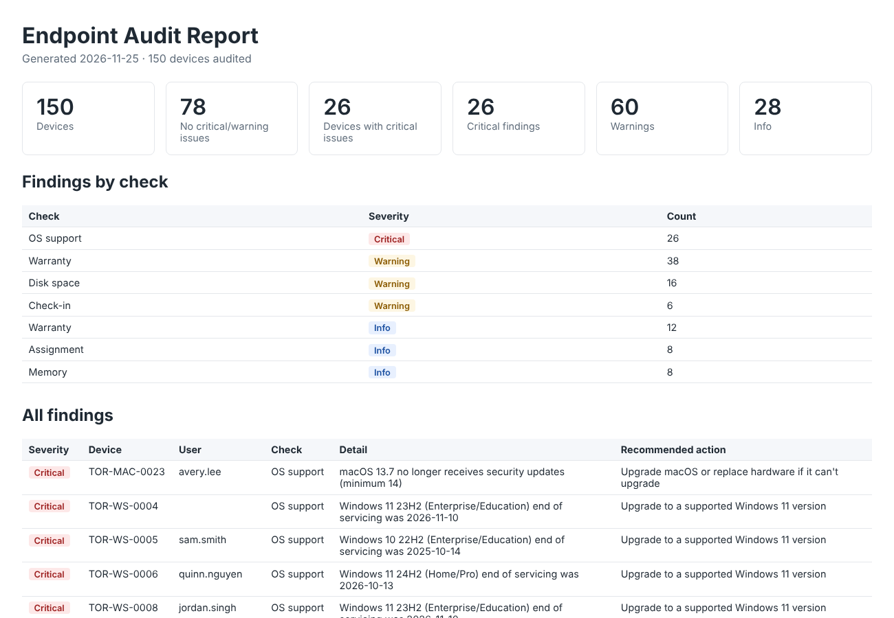

# IT Endpoint Audit

A Python command-line tool that reads a device inventory and flags laptops and desktops that need
IT attention:
- an operating system past (or close to) end of servicing
- a nearly full disk
- a device that has stopped checking in
- an expired warranty
- low RAM
- no assigned user

It writes a CSV of findings for tracking and an HTML report that can be shared with the team.

It also includes a collector that gathers the same details from a real Windows, macOS or Linux
machine. That means the inventory can be built automatically instead of by hand.



## Why

Windows 10 reached end of servicing on October 14, 2025, and Windows 11 feature versions each
have their own end dates, which differ between Home/Pro and Enterprise/Education editions. Keeping
track of which devices are affected, along with disk space, warranties and devices nobody has
used in months, is repetitive help desk work that's easy to automate.

## Quick start

```bash
pip install -r requirements.txt     # only needed for collect.py

# Audit the included 150-device sample fleet
python3 audit.py sample_data/inventory.csv --today 2026-11-25
```
```
Audited 150 devices on 2026-11-25
  Critical 26
  Warning  60
  Info     28
Wrote reports/findings_2026-11-25.csv and reports/audit_report_2026-11-25.html
```

## Collecting real device data

```bash
python3 collect.py --print                                    # preview this machine's details
python3 collect.py --inventory \\fileserver\it\inventory.csv --department Finance
```

The collector adds the machine to the inventory, or updates its row if the hostname is already
there. Existing department and warranty values are kept. A few details need special handling:
- **Windows 11 version:** Some Python versions report Windows 11 as "10" through the
  `platform` module, and it doesn't give the feature version. The collector uses the build number (22000 or higher means Windows 11) and
  reads `DisplayVersion` and `EditionID` from the registry instead.
- **Disk space:** checked on the system drive.
- **RAM:** read with `psutil`.

To keep the inventory current, run `collect.py` from Windows Task Scheduler or a login script.

## Checks

| Check | Critical | Warning | Info |
|---|---|---|---|
| OS support | Past end of servicing | Ends within 180 days, or unknown version | OS not in lifecycle table |
| Disk space | < 5% free | < 15% free | |
| Check-in | | Not seen in 30+ days, or never | |
| Warranty | | Expired | Expires within 90 days, or no date recorded |
| Memory | | | Under 8 GB |
| Assignment | | | No assigned user |

- All thresholds and OS end-of-servicing dates are in `config/config.json`, so they can be
  updated without touching code.
- A record with bad data (for example `ram_gb = "sixteen"`) becomes a "Data quality" finding
  instead of crashing the audit.

## Running on a schedule

`--fail-on critical` makes the script exit with code 1 when any critical finding exists. A
scheduled task or CI job can use that to send an alert:

```bash
python3 audit.py inventory.csv --out reports --fail-on critical
```

## Inventory format

The CSV has these columns:

```
hostname, assigned_user, department, model, os_name, os_version, os_edition,
ram_gb, disk_total_gb, disk_free_gb, last_seen, warranty_end
```

- `os_name` is `Windows 10`, `Windows 11` or `macOS`.
- `os_version` is the feature version, like `24H2`, or the macOS version, like `15.7`.
- Dates use the `YYYY-MM-DD` format.

`sample_data/make_sample_inventory.py` generates a made-up fleet in this format. No real company
or user data is included.

## Tests

```bash
python3 -m unittest discover -s tests -t . -v
```

There are 14 unit tests. They cover each check's thresholds, the Pro vs. Enterprise end dates,
and handling of bad data.

## Project structure

```
audit.py                  CLI: audit an inventory, write reports
collect.py                CLI: collect this machine's details into the inventory
endpoint_audit/checks.py  one function per check
endpoint_audit/report.py  CSV + HTML output
config/config.json        thresholds and OS lifecycle dates
sample_data/              sample fleet + generator
tests/                    unit tests
```

## Possible next steps
- Collect serial numbers and look up warranty dates from vendor APIs
- Pull inventory directly from Active Directory or Intune instead of a CSV
- Email the HTML report to the IT team after each scheduled run
